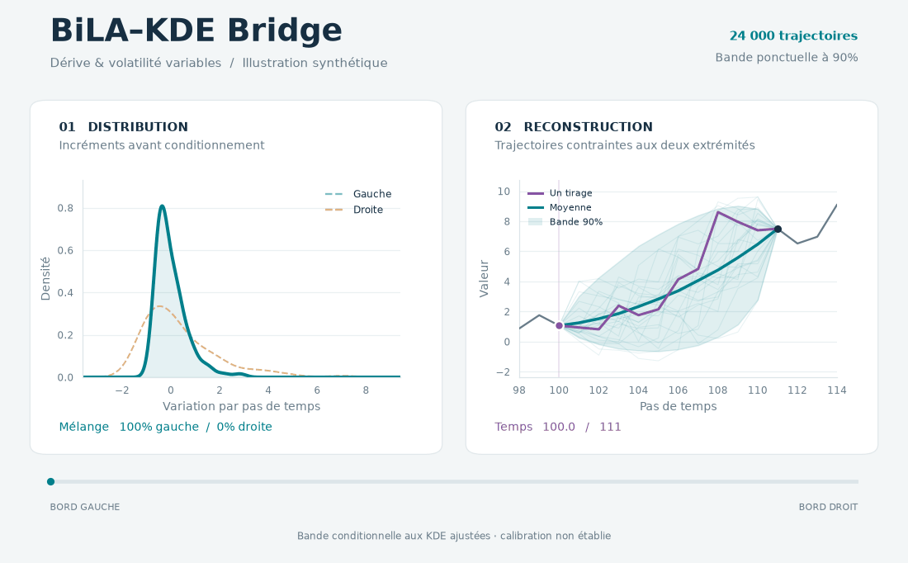
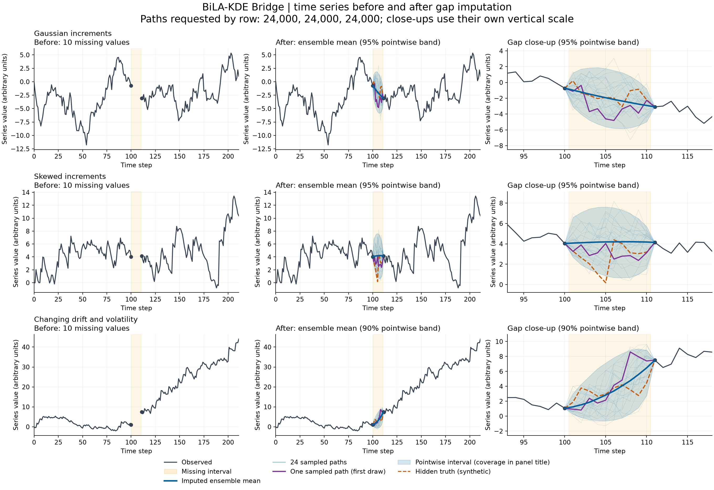

# BiLA-KDE Bridge

**Stochastic interpolation for time series with a missing interval.** Learn local increment distributions on both sides of a gap, then draw trajectories that meet both observed endpoints exactly.



The animation follows changing drift and volatility: the fitted increment density evolves across the gap while a sampled trajectory connects its endpoints. The shaded region is a checked **90% pointwise conditional band** for this illustration; it is not a simultaneous path band or a demonstrated predictive coverage rate.

## What it does

- Fits Gaussian kernel density estimates to observed increments before and after one internal gap.
- Blends the two densities across time and conditions their joint distribution on the observed endpoint displacement.
- Returns sampled paths, an ensemble-mean completed series and precision-checked quantiles.
- Supports NumPy arrays and pandas Series with regular datetime indices.
- Reports diagnostic or resource failures explicitly through typed exceptions.

This is a **research prototype**. It assumes independent increments before endpoint conditioning and represents uncertainty conditional on fitted KDEs. Explicit serial dependence and uncertainty in the estimated densities are future work.

## Quick start

Requires **Python 3.13+** and [uv](https://docs.astral.sh/uv/).

```sh
git clone https://github.com/Yosri-Ben-Halima/BiLA-KDE-stochastic-interpolator.git
cd BiLA-KDE-stochastic-interpolator
uv sync
uv run python examples/quickstart.py
```

Use the API in a Python script:

```python
import numpy as np
from bilakde import BiLAKDEBridge, BridgeError


def main():
    rng = np.random.default_rng(8)
    series = np.r_[0.0, np.cumsum(rng.normal(size=211))]
    series[101:111] = np.nan  # One internal gap; both endpoints observed.

    try:
        result = BiLAKDEBridge(random_state=42).fit_transform(
            series, n_samples=4000
        )
        completed = result.imputed_series  # Mean reconstruction inside the gap.
        paths = result.samples            # (4000, 12), including fixed endpoints.
        print(completed[100:112])
        print(paths.shape)
        print(result.diagnostics)

        # Additional precision checks apply to requested pointwise quantiles.
        band = result.quantiles([0.025, 0.5, 0.975])
        print(band.values)
    except BridgeError as exc:
        print("Unsuccessful:", exc.status, exc.reason)
        print(exc.diagnostics)


if __name__ == "__main__":
    main()
```

The main guard is required because inference runs in a supervised worker process. Default limits are **60 seconds and 2 GiB per fit**, configurable through `SamplingConfig`. A path ensemble can pass its diagnostic screen while a requested quantile band fails its separate precision check. Observed values are preserved.

## Before and after



Gaussian increments, skewed increments, and changing drift/volatility illustrate the output. One sampled path is fully opaque; the other paths show ensemble variation. The first two illustrations have checked 95% pointwise bands; the third has a labeled 90% band after its 95% precision check failed. **These examples illustrate behavior; they do not establish calibration or superiority.**

See [example interpretation](results/examples/README.md) and the [complete usage guide](docs/usage/guide.md) for regeneration commands and diagnostic details. Only the current GIF and gallery are retained; intermediate chains and older GIFs are excluded.

## Evidence and current limits

The recorded corrected-source validation passed **125 tests** with one Windows fixture skip and a **51/51 smoke stage**. These are historical source-specific results; see the [verification record](docs/validation/VERIFICATION.md).

The larger comparative campaign was interrupted. Its recovered accounting retained **691 successful applications, 101 timeouts and 4,368 untested applications**. BiLA and pooled KDE both timed out on every attempted 100-point gap. Short-gap comparisons were mixed: **a general predictive advantage of BiLA-KDE has not been established**. Source-provenance and incomplete-replication limitations remain explicit in the [research conclusions](docs/research/RESEARCH_CONCLUSIONS.md).

Current work investigates long-gap computation and precision before another large campaign. The model accepts one regularly sampled univariate internal gap; multiple or boundary gaps, irregular sampling and degenerate increment windows fail explicitly. Default fitting windows require 100 observed increments on each side; configurable windows require at least 20 per side.

## Development and documentation

```sh
uv run pytest -q
uv run ruff check src tests benchmarks scripts examples main.py
uv build
```

- [Documentation index](docs/README.md): mathematics, research, validation and usage.
- [Executive summary by epic](docs/research/EXECUTIVE_SUMMARY.md): delivered work and qualified findings.
- [References](docs/research/REFERENCES.md): papers, textbooks and software foundations.
- [Original research proposal](docs/context/formalisation.md): broader ambitions; implemented scope is described above.

The repository includes a local read-only task dashboard (`uv run python -m scripts.issue_dashboard --open`). Its live Markdown tracker is private workspace state under `.scratch/`; a fresh checkout has no local campaign history. Experiment archives under `results/` are also excluded, except the curated examples above. Documentation distinguishes those local evidence paths from publicly included files.
