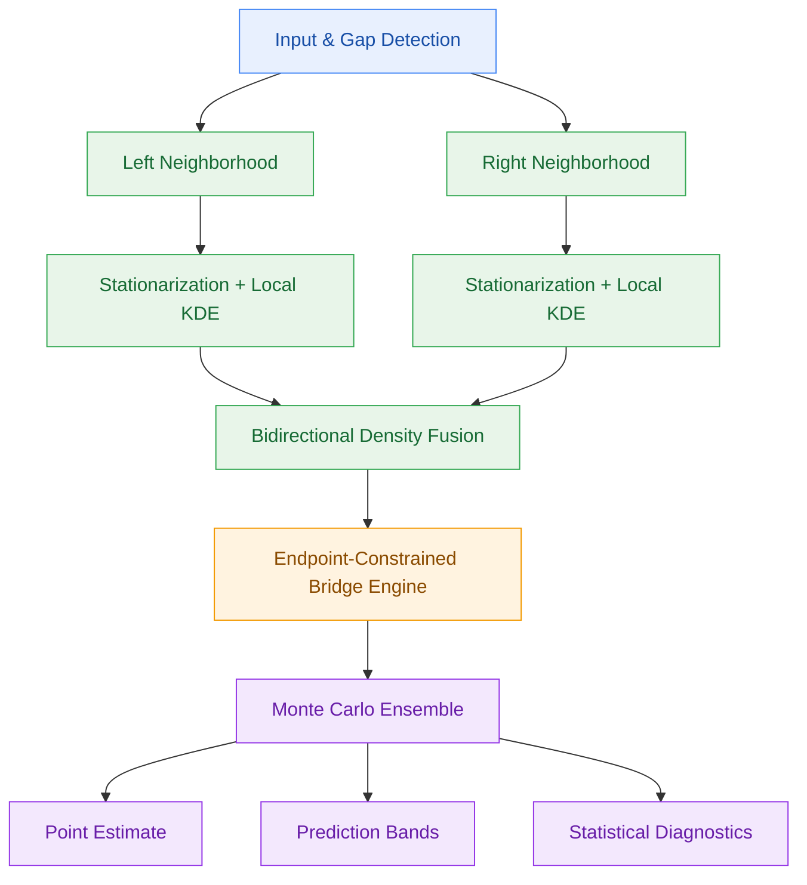

# BiLA-KDE Bridge

Bidirectional Locally Adaptive Kernel Density Estimation for Stochastic Time-Series Interpolation

Research & Development Project Specification · v1.0

## 1. Executive summary

BiLA-KDE Bridge is a nonparametric, probabilistic framework for reconstructing contiguous missing intervals in univariate time series.

Unlike conventional interpolation methods that produce a single deterministic trajectory, BiLA-KDE Bridge generates an ensemble of statistically plausible trajectories that:

1. Connect the observed endpoints exactly, using a stochastic bridge construction inspired by Brownian bridges.
2. Learn stochastic behavior from both sides of the gap, using kernel density estimation (KDE).
3. Adapt locally to variations in drift, dispersion, and potentially different dynamics before and after the missing interval.
4. Preserve statistical characteristics of the observed process to the extent supported by the estimated model, including increment distributions and, in advanced versions, temporal dependence.
5. Quantify interpolation uncertainty, providing confidence-independent probabilistic summaries such as conditional quantile bands and predictive intervals.

The intended output is not merely an imputed series but an approximation to the conditional distribution of the missing trajectory.

PRIMARY RESEARCH OBJECTIVE

$$ \boxed{ \hat p(X_{1:T-1}\mid X_0=a,X_T=b,\mathcal D_L,\mathcal D_R) } $$

Estimate and sample the joint conditional distribution of missing observations, given fixed boundary values and observed data to the left and right of the missing interval.

## 2. Problem definition

Consider a discrete-time series:

$$ X=\{X_t\}_{t=1}^{N} $$

A contiguous interval of length $T-1$ is missing, with observed boundary values:

$$ X_0=a,\qquad X_T=b $$

Reindexing the gap locally, define the observed neighborhoods:

$$ \mathcal D_L=\{X_{-L},\ldots,X_0\} $$

$$ \mathcal D_R=\{X_T,\ldots,X_{T+R}\} $$

The reconstruction problem is to estimate:

$$ \mathbf X_{\mathrm{miss}}=(X_1,\ldots,X_{T-1}) $$

subject to the hard constraints:

$$ \boxed{ P(X_0=a)=P(X_T=b)=1 } $$

For an ensemble of $M$ simulated paths, every realization must satisfy:

$$ X_0^{(m)}=a,\quad X_T^{(m)}=b,\quad m=1,\ldots,M $$

The method must not introduce artificial discontinuities at the gap boundaries.

## 3. Scientific hypotheses

| ID | Hypothesis                                                                                                                             |
| -- | -------------------------------------------------------------------------------------------------------------------------------------- |
| H1 | KDE-based innovation modeling improves distributional fidelity over Gaussian bridge baselines for sufficiently non-Gaussian processes. |
| H2 | Bidirectional estimation improves reconstruction quality when local dynamics differ across the gap.                                    |
| H3 | Locally adaptive density estimation improves performance under smoothly time-varying stochastic dynamics.                              |
| H4 | Conditional KDE bridges preserve temporal dependence better than bridges driven by independent KDE innovations.                        |
| H5 | Probabilistic path reconstruction provides better-calibrated uncertainty than deterministic interpolation.                             |

These are testable hypotheses, not assumed properties of the proposed estimator.

## 4. Statistical methodology

### 4.1 Transformation and stationarization

The original series is decomposed into:

$$ X_t=\mu(t)+Y_t $$

where $\mu(t)$ describes deterministic components and $Y_t$ is the stochastic residual process.

Two candidate transformations are supported:

Increment model

$$ R_t=X_t-X_{t-1} $$

Suitable for integrated or locally random-walk-like processes.

Detrended residual model

$$ Y_t=X_t-\hat\mu(t) $$

Suitable when an identifiable deterministic trend or seasonal component exists.

The transformation must be estimated using only genuinely observed data. Inverse transformation must preserve both original endpoint values.

The initial implementation prioritizes the increment model, while retaining detrending as a configurable alternative.

### 4.2 Bidirectional local KDE

Define valid observed increments separately on the left and right sides:

$$ \mathcal R_L=\{r_i^{(L)}\}_{i=1}^{n_L} $$

$$ \mathcal R_R=\{r_j^{(R)}\}_{j=1}^{n_R} $$

Estimate two innovation densities:

$$ \hat f_L(r)=\frac{1}{n_Lh_L}\sum_{i=1}^{n_L} K\left(\frac{r-r_i^{(L)}}{h_L}\right) $$

$$ \hat f_R(r)=\frac{1}{n_Rh_R}\sum_{j=1}^{n_R} K\left(\frac{r-r_j^{(R)}}{h_R}\right) $$

Here $h_L$ and $h_R$ are bandwidth parameters, selected independently where appropriate.

This allows the two neighborhoods to exhibit different empirical innovation distributions.

### 4.3 Locally adaptive density blending

Let:

$$ u_t=\frac{t}{T} $$

Define a temporally adaptive innovation density:

$$ \boxed{ \hat f_t(r)=w(u_t)\hat f_L(r)+[1-w(u_t)]\hat f_R(r) } $$

where:

$$ 0\leq w(u)\leq1 $$

A baseline weight function is:

$$ w(u)=1-u $$

A more flexible family is:

$$ w(u;\alpha,\beta) = \frac{(1-u)^\alpha} {(1-u)^\alpha+u^\beta} $$

for positive $\alpha,\beta$, with endpoint values defined by continuity.

The initial model will support fixed linear weighting, while subsequent experiments will investigate data-driven weighting calibrated on held-out gaps.

The blend evolves the distribution of innovations across the interval. It does not assume that the missing observations themselves follow a linear trend.

### 4.4 Stochastic bridge construction

Generate innovations from the time-varying mixture:

$$ \varepsilon_t\sim\hat f_t,\quad t=1,\ldots,T $$

Form a cumulative innovation process:

$$ S_t=\sum_{j=1}^{t}\varepsilon_j,\qquad S_0=0 $$

Then construct the endpoint-constrained trajectory:

$$ \boxed{ X_t^* = a+\frac{t}{T}(b-a) + S_t-\frac{t}{T}S_T } $$

This is the principal baseline BiLA-KDE bridge operator.

It guarantees:

$$ X_0^*=a,\qquad X_T^*=b $$

for every realization.

The resulting increment equation is:

$$ \Delta X_t = \frac{b-a}{T} + \varepsilon_t - \frac{S_T}{T} $$

Consequently, the endpoint correction couples all innovations.

This baseline guarantees exact boundary matching but does not generally preserve the original KDE innovation distributions after correction. Nor is it, in general, an exact draw from the KDE-implied conditional distribution.

These limitations will be measured explicitly rather than treated as negligible.

### 4.5 Statistically conditioned bridge extension

The second major methodological component replaces simple correction with conditional path sampling.

For independent, time-varying innovations, define the unconditioned joint density:

$$ q(\mathbf r)=\prod_{t=1}^{T}\hat f_t(r_t) $$

The required bridge distribution is the conditional law of this model given:

$$ \sum_{t=1}^{T}r_t=b-a $$

A convenient expression for the density of the first $T-1$ increments is:

$$ \boxed{ p(r_{1:T-1}\mid \sum r_t=b-a) = \frac{ \left[\prod_{t=1}^{T-1}\hat f_t(r_t)\right] \hat f_T\left(b-a-\sum_{t=1}^{T-1}r_t\right) }{ f_{\Sigma R}(b-a) } } $$

where $f_{\Sigma R}$ is the density of the total increment under the independent-innovation model.

This distribution enforces the endpoint constraint exactly while conditioning according to the KDE innovation model.

Candidate inference methods include MCMC and sequential Monte Carlo with endpoint-guided proposals.

For models with temporal dependence, the independent product is replaced with a sequence of conditional transition densities, estimated using conditional KDE.

This conditioned sampler is the main methodological target. The linearly corrected bridge serves as a computationally efficient reference method.

## 5. System architecture

The framework will follow a modular design to separate statistical modeling, simulation, and evaluation.



### Proposed Python API

```python
from bilakde import BiLAKDEBridge

model = BiLAKDEBridge(
    transformation="diff",
    kernel="gaussian",
    bandwidth="cv",
    window_size=100,
    blending="adaptive",
    bridge_method="conditional_smc",
    n_particles=2000,
    random_state=42,
)

result = model.fit_transform(
    series=ts,
    n_samples=1000,
)

# Complete representative reconstruction
result.imputed_series

# Monte Carlo trajectories
result.samples

# Pointwise predictive intervals
result.quantiles([0.025, 0.5, 0.975])

# Validation and statistical diagnostics
result.diagnostics
```

This is the intended API design, not an existing implementation.

The library should also support multiple separate gaps, uneven observation frequencies (after accounting for actual elapsed time), and user-provided local estimation windows.

## 6. Experimental design

### 6.1 Synthetic benchmark

Three primary data-generating processes will be used.

| DGP                    | Statistical feature             | Research question                                                        |
| ---------------------- | ------------------------------- | ------------------------------------------------------------------------ |
| AR(1)                  | Autocorrelation, mean reversion | Does the conditional bridge preserve serial dependence?                  |
| GARCH(1,1)             | Conditional heteroskedasticity  | Can the interpolator capture volatility clustering?                      |
| Regime-switching AR(1) | Structural changes              | Does bidirectional adaptation help when behavior differs across the gap? |

Additional experiments could include skewed or multimodal innovations and nonlinear autoregressive processes.

Missing blocks will be introduced artificially at different lengths relative to the series' characteristic dependence timescale.

Illustrative masking scenarios

## 5–10

Short gaps

## 20–50

Medium gaps

## 100+

Long gaps

Numbers represent missing timesteps and are starting experimental categories, not universal thresholds.

### 6.2 Real-world validation

Initial candidate application domains:

- Industrial sensor data: NASA C-MAPSS or suitable publicly available process-monitoring datasets.
- Energy: UCI Individual Household Electric Power Consumption, or a smart-meter dataset with regular measurement intervals.
- Finance: S&P 500 intraday price data, subject to data availability and appropriate treatment of trading-session boundaries.

Masking should use complete observed intervals so that actual hidden trajectories are known for evaluation.

### 6.3 Benchmark methods

| Family                 | Candidate baselines                                                                    |
| ---------------------- | -------------------------------------------------------------------------------------- |
| Deterministic          | Linear interpolation, cubic spline, PCHIP                                              |
| Parametric stochastic  | Gaussian random-walk bridge, AR/Kalman smoother                                        |
| Nonparametric          | Unidirectional KDE, pooled KDE, KDE bridge with linear correction                      |
| Advanced probabilistic | Gaussian-process regression, diffusion-based imputation where computationally feasible |
| Proposed               | Bidirectional adaptive KDE, conditional KDE bridge                                     |

All methods should use the same observed data and train/test partitions. Hyperparameters must be selected without access to the artificially hidden values in the evaluation set.

## 7. Evaluation framework

The project has three complementary objectives: reconstruction accuracy, statistical fidelity, and uncertainty quality.

### Reconstruction accuracy

For a point estimate $\hat X_t$, assess:

$$ \operatorname{RMSE} = \sqrt{\frac1{T-1}\sum_{t=1}^{T-1}(X_t-\hat X_t)^2} $$

Also report MAE.

These metrics evaluate the representative reconstruction, not the full probabilistic model.

### Statistical fidelity

Compare empirical properties of observed and generated trajectories, accounting for the conditioning on endpoints:

- Increment distribution: Wasserstein distance and distributional diagnostics.
- Serial dependence: autocorrelation function discrepancy.
- Conditional volatility: ACF of squared increments and volatility clustering diagnostics.
- Frequency structure: spectral distance where applicable.
- Extremes: tail quantiles and jump-frequency discrepancy.

Because true bridges have endpoint-induced dependence, the primary reference should be the distribution of true masked paths conditioned on comparable endpoints, not just the unconditioned distribution of the original series.

### Probabilistic calibration

The interpolator produces predictive intervals:

$$ [\hat q_{\alpha/2}(t),\hat q_{1-\alpha/2}(t)] $$

Evaluate pointwise coverage:

$$ \operatorname{PICP} = \frac{1}{T-1} \sum_{t=1}^{T-1} \mathbf 1 \left\{ X_t\in[\hat q_{\alpha/2}(t),\hat q_{1-\alpha/2}(t)] \right\} $$

For a nominal 95% interval, coverage should approach 95% across held-out experiments. Average interval width should be reported to detect trivially wide intervals.

Additional metrics include CRPS for marginal predictive distributions and energy scores for entire paths.

A separate simultaneous-coverage evaluation is necessary if uncertainty bands are intended to cover whole trajectories rather than individual timestamps.

### Experimental ablations

To isolate the actual value of each component, evaluate:

| Configuration                     | What it tests                                                        |
| --------------------------------- | -------------------------------------------------------------------- |
| Pooled KDE + linear correction    | Basic nonparametric bridge                                           |
| Left-only KDE                     | Value of pre-gap information                                         |
| Right-only KDE                    | Value of post-gap information                                        |
| 50/50 mixture                     | Value of combining both neighborhoods                                |
| Linearly varying mixture          | Value of temporal adaptation                                         |
| Learned mixture weights           | Value of data-driven adaptation                                      |
| Conditional KDE + bridge sampling | Value of modeling dynamics and the endpoint-conditioned distribution |

## 8. Success criteria

The following are proposed acceptance criteria for the first research prototype, to be assessed on held-out benchmarks.

| Criterion                 | Target                                                                                           |
| ------------------------- | ------------------------------------------------------------------------------------------------ |
| Boundary consistency      | Exact equality within numerical precision for every generated path                               |
| Model validity            | No NaN or infinite outputs for valid test inputs                                                 |
| Reconstruction accuracy   | Competitive with standard interpolation and smoothing baselines                                  |
| Probabilistic calibration | Empirical interval coverage close to nominal coverage, with interval widths reported             |
| Statistical fidelity      | Measurable improvement over simple KDE bridging on at least one non-Gaussian or time-varying DGP |
| Reproducibility           | Deterministic runs under fixed seeds, versioned configurations                                   |
| Computational performance | Benchmark runtime and memory scaling across gap lengths and ensemble sizes                       |

The target is not to guarantee superiority on every dataset. For simple smooth signals, linear or spline interpolation may remain preferable.

## 9. Implementation plan

#### W1

Foundation and reproducible benchmarks

Implement synthetic data generators, gap masking, baseline interpolation methods and evaluation metrics.

Deliverable: benchmark suite + baseline report

#### W2

Bidirectional KDE baseline

Implement density estimation, bandwidth tuning, temporal mixtures and endpoint-corrected simulation.

Deliverable: BiLA-KDE v0.1 with exact endpoint tests

#### W3–4

Conditional bridge and dependency modeling

Implement a rigorously conditioned sampler, first for independent KDE innovations, then investigate conditional KDE transitions.

Deliverable: conditional sampler + diagnostics

#### W5

Adaptive modeling and ablations

Evaluate local weighting functions, regime changes and the benefit of using both neighborhoods.

Deliverable: ablation study

#### W6

Real-data evaluation and packaging

Conduct real-data benchmarks, refine numerical stability, package the library and document limitations.

Deliverable: Python package, technical report and reproducible examples

Indicative six-week roadmap for a focused research prototype, not a production deployment estimate.

## 10. Technical risks and mitigation

| Risk                                                        | Mitigation                                                                                 |
| ----------------------------------------------------------- | ------------------------------------------------------------------------------------------ |
| Few samples around gaps                                     | Minimum-window checks, wider estimation neighborhoods and parametric fallback              |
| KDE curse of dimensionality                                 | Low-order conditional models, adaptive bandwidth and dimensionality reduction              |
| Endpoint displacement is unlikely under learned innovations | Monitor bridge likelihood and effective sample size; flag poorly supported reconstructions |
| Abrupt regime changes                                       | Change-point detection and regime-mixture extensions                                       |
| Nonstationarity                                             | Local modeling, decomposition and diagnostic tests                                         |
| Particle degeneracy on long gaps                            | Guided proposals, resampling and MCMC rejuvenation                                         |
| Overconfident uncertainty estimates                         | Held-out calibration tests and predictive diagnostics                                      |
| Missingness depends on unobserved values                    | Explicit missingness assumptions and sensitivity analysis                                  |

A particularly important point is that exactly matching the two endpoints does not guarantee that the reconstructed path is realistic. Endpoint consistency is a necessary constraint, whereas statistical fidelity and uncertainty calibration must be established empirically.

## 11. Expected deliverables

The project will produce a reusable Python library, a reproducible experiment suite, a technical research report, and a collection of real-world case studies.

A publication-oriented report would have the following structure:

1. Introduction and problem formulation.
2. Related work on time-series imputation, conditional density estimation, and stochastic bridges.
3. Bidirectional locally adaptive KDE methodology.
4. Endpoint-conditioned path sampling.
5. Synthetic experiments and ablations.
6. Real-world case studies.
7. Limitations, computational complexity, and further extensions.

## 12. Official project abstract

# BiLA-KDE Bridge

**Bidirectional Locally Adaptive Kernel Density Estimation for Stochastic Time-Series Interpolation**

### Project Abstract

This project proposes a nonparametric probabilistic framework for imputing contiguous missing intervals in time series through endpoint-constrained stochastic interpolation.

The proposed method combines bidirectional kernel density estimation (KDE), locally adaptive innovation modeling, and stochastic bridge construction to generate ensembles of plausible missing trajectories that exactly connect the observed boundary values.

Unlike classical interpolation techniques, which generally produce deterministic point estimates, BiLA-KDE Bridge aims to approximate the conditional distribution of missing observations while accounting for the stochastic characteristics of the surrounding data.

The methodology estimates innovation distributions independently from observations preceding and following the missing interval. These distributions are combined through a time-varying weighting mechanism to accommodate potentially evolving local dynamics. A stochastic bridge operator then enforces exact endpoint consistency for every simulated trajectory.

The research distinguishes between a computationally efficient endpoint-corrected KDE bridge and a statistically conditioned bridge that samples from the joint trajectory distribution implied by the underlying stochastic model.

Experimental validation will investigate reconstruction accuracy, distributional fidelity, temporal dependence, and probabilistic calibration using synthetic autoregressive, heteroskedastic, and regime-switching processes, followed by real-world industrial, energy, and financial time-series datasets.

The expected contribution is an interpretable, computationally accessible probabilistic imputation framework offering a nonparametric alternative to conventional deterministic interpolation and more computationally intensive deep generative approaches.

**Keywords:** Time-Series Imputation, Missing Data, Kernel Density Estimation, Stochastic Bridges, Conditional Simulation, Nonparametric Statistics, Probabilistic Forecasting.

## 13. Research positioning

The project's strongest potential contribution is the combination of three ideas:

Bidirectionality: Learning local stochastic behavior from both observed neighborhoods instead of extrapolating from one side.

Adaptive nonparametric modeling: Allowing the innovation distribution to vary throughout the missing interval without imposing a single parametric family.

Exact bridge conditioning: Generating plausible joint trajectories that respect observed boundaries, rather than separately imputing each missing value.

However, the combination should not be described as mathematically novel until a systematic literature review has established what differentiates it from existing kernel-based bridge sampling and nonparametric conditional simulation methods.

For the initial research effort, I would prioritize demonstrating that the bidirectional adaptive model outperforms a pooled KDE bridge in time-varying or regime-changing environments, while maintaining competitive uncertainty calibration. That gives the project a specific, falsifiable contribution rather than an overly broad claim about preserving every statistical property.